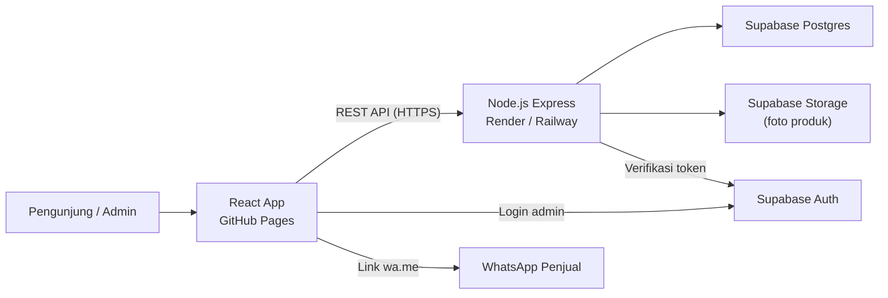
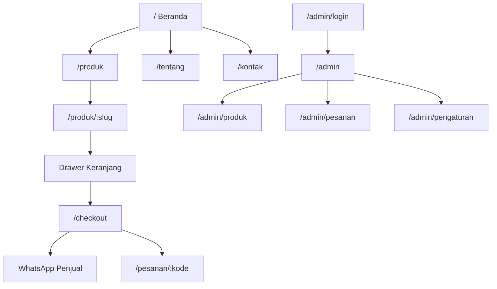
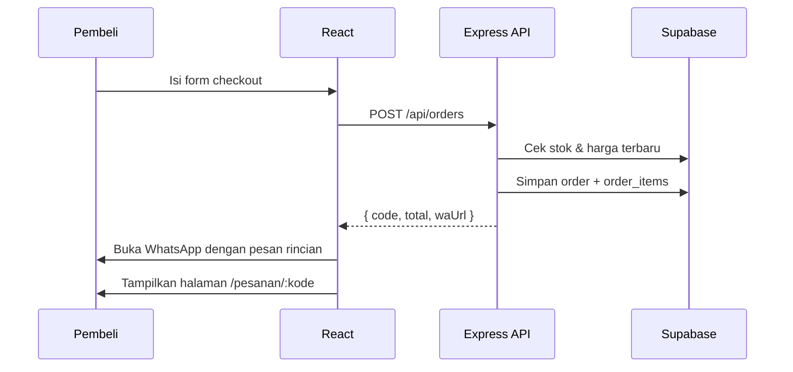

# Rancangan Website UMKM

> Stack: **React (Vite) + Node.js (Express) + Supabase**
> Frontend di-deploy ke **GitHub Pages**, backend ke **Render** (gratis) atau **Railway**, database & storage di **Supabase** (gratis).

Bagian bertanda `[ISI]` perlu kamu lengkapi dengan data asli usahamu (nama, produk, foto, alamat). Jangan diganti dengan data karangan.

---

## Daftar Isi

1. [Gambaran Umum](#1-gambaran-umum)
2. [Arsitektur Sistem](#2-arsitektur-sistem)
3. [Palet Warna](#3-palet-warna)
4. [Tipografi, Spasi, dan Komponen](#4-tipografi-spasi-dan-komponen)
5. [Desain Utama & Tampilan Halaman](#5-desain-utama--tampilan-halaman)
6. [Struktur Web (Sitemap & Alur)](#6-struktur-web-sitemap--alur)
7. [Struktur Folder](#7-struktur-folder)
8. [Konfigurasi Frontend](#8-konfigurasi-frontend)
9. [Konfigurasi Backend](#9-konfigurasi-backend)
10. [Database Supabase](#10-database-supabase)
11. [Deployment](#11-deployment)
12. [Roadmap Pengerjaan](#12-roadmap-pengerjaan)

---

## 1. Gambaran Umum

| Item | Keterangan |
|---|---|
| Nama usaha | `[ISI]` |
| Jenis produk | `[ISI]` (contoh: makanan, kerajinan, fashion) |
| Target pengunjung | Pembeli lokal yang menemukan toko lewat Instagram/WhatsApp/Google Maps |
| Tujuan utama | Pengunjung melihat katalog lalu memesan lewat WhatsApp |
| Tujuan kedua | Pemilik bisa mengelola produk sendiri lewat halaman admin |

**Fitur inti (versi 1):**

- Katalog produk dengan filter kategori dan pencarian
- Detail produk (foto, harga, deskripsi, stok)
- Keranjang belanja (disimpan di browser)
- Checkout: pesanan tersimpan di database, lalu pembeli diarahkan ke WhatsApp dengan pesan otomatis berisi rincian pesanan
- Halaman Tentang (cerita usaha) dan Kontak (alamat, jam buka, peta)
- Dashboard admin: login, tambah/edit/hapus produk, upload foto, lihat & ubah status pesanan

**Di luar versi 1** (bisa ditambah nanti): payment gateway (Midtrans/Xendit), ongkir otomatis, akun pembeli.

---

## 2. Arsitektur Sistem



**Kenapa begini:**

- GitHub Pages hanya bisa menyajikan file statis, jadi React di-build menjadi HTML/JS/CSS biasa.
- Node.js menyimpan kunci rahasia Supabase (`service_role`) supaya tidak pernah bocor ke browser, dan menjadi tempat logika bisnis (hitung total, cek stok, validasi).
- Supabase menyediakan Postgres, Auth, dan Storage dalam satu paket gratis, jadi tidak perlu tiga layanan terpisah.

### Perbandingan hosting backend (paket gratis)

| Layanan | Status gratis | Catatan |
|---|---|---|
| **Supabase** | Gratis permanen | 2 project, DB 500 MB, Storage 1 GB. Project di-*pause* jika tidak ada aktivitas selama 7 hari (bisa di-*restore* dari dashboard). |
| **Render** (rekomendasi untuk Node.js) | Gratis permanen | Server "tidur" setelah 15 menit tanpa request; request pertama setelah tidur butuh sekitar 30 sampai 60 detik. |
| **Railway** | Hanya kredit trial | Setelah kredit trial habis perlu paket berbayar (sekitar US$5/bulan). Bagus kalau nanti mau upgrade. |

> Kebijakan harga bisa berubah, cek halaman pricing masing-masing sebelum deploy.

**Pilihan akhir:** Supabase (DB + Auth + Storage) + Render (Express API). Kode backend dibuat netral sehingga bisa dipindah ke Railway tanpa perubahan.

---

## 3. Palet Warna

Aturan **60 / 30 / 10**:

| Porsi | Nama | Hex | Peran |
|---|---|---|---|
| **60%** | Krem Gading / Putih Hangat | `#FDFBF7` | Latar halaman, latar kartu, ruang kosong |
| **30%** | Cokelat Kayu / Taupe | `#4A3B32` | Teks utama, navbar, footer, garis, ikon |
| **10%** | Hijau Daun | `#556B2F` | Tombol aksi utama, link aktif, harga, status sukses |

### Warna turunan (pendukung, bukan warna baru)

Diturunkan dari tiga warna utama agar palet tetap konsisten.

| Token | Hex | Dipakai untuk |
|---|---|---|
| `--cream-100` | `#FDFBF7` | Latar utama |
| `--cream-200` | `#F5EFE6` | Latar section selang, input, kartu hover |
| `--cream-300` | `#E8DFD2` | Garis pembatas, border kartu (dekoratif saja, bukan teks) |
| `--brown-900` | `#4A3B32` | Teks utama, heading, footer |
| `--brown-600` | `#6B5A4E` | Teks sekunder (caption, keterangan) |
| `--green-600` | `#556B2F` | Tombol utama, link |
| `--green-700` | `#44561F` | Hover/pressed tombol hijau |
| `--green-100` | `#EEF1E6` | Latar badge status "Tersedia" |
| `--danger` | `#A23B2A` | Pesan error, stok habis (merah bata, tetap earth tone) |

### Uji kontras (WCAG AA, minimal 4.5:1 untuk teks normal)

| Kombinasi | Rasio | Hasil |
|---|---|---|
| `#4A3B32` di atas `#FDFBF7` | ~10.3 : 1 | Lolos AAA |
| `#6B5A4E` di atas `#FDFBF7` | ~6.3 : 1 | Lolos AA |
| `#556B2F` di atas `#FDFBF7` | ~5.8 : 1 | Lolos AA |
| `#FDFBF7` di atas `#556B2F` (teks tombol) | ~5.8 : 1 | Lolos AA |
| `#FDFBF7` di atas `#4A3B32` (footer) | ~10.3 : 1 | Lolos AAA |
| `#A23B2A` di atas `#FDFBF7` | ~6.3 : 1 | Lolos AA |

> Jangan memakai `--cream-300` untuk teks; kontrasnya terlalu rendah.

### Cara menjaga porsi 10%

Hijau hanya muncul di **satu titik fokus per layar**: tombol "Pesan via WhatsApp", harga, dan menu aktif. Ikon, garis, dan heading tetap cokelat. Kalau hijau ada di mana-mana, aksennya kehilangan fungsi.

---

## 4. Tipografi, Spasi, dan Komponen

### Tipografi

| Peran | Font | Alasan |
|---|---|---|
| Heading | **Fraunces** (serif, Google Fonts) | Bentuk huruf lembut dan sedikit "tangan", cocok dengan kesan kayu dan buatan sendiri |
| Body & UI | **Plus Jakarta Sans** (Google Fonts) | Didesain di Indonesia, sangat terbaca di layar HP, netral untuk harga dan form |

Skala ukuran (rem, basis 16px):

| Token | Ukuran | Pemakaian |
|---|---|---|
| `--fs-display` | `clamp(2.25rem, 5vw, 3.5rem)` | Judul hero (satu `h1` per halaman) |
| `--fs-h2` | `clamp(1.75rem, 3.5vw, 2.5rem)` | Judul section |
| `--fs-h3` | `1.25rem` | Nama produk, judul kartu |
| `--fs-body` | `1rem` | Paragraf |
| `--fs-small` | `0.875rem` | Caption, label |

### Spasi, radius, bayangan

```css
--space-1: 4px;   --space-2: 8px;   --space-3: 12px;  --space-4: 16px;
--space-6: 24px;  --space-8: 32px;  --space-12: 48px; --space-16: 64px; --space-24: 96px;

--radius-sm: 6px;   /* input, badge */
--radius-md: 12px;  /* kartu produk, tombol */
--radius-lg: 20px;  /* foto hero, panel besar */

--shadow-card: 0 2px 8px rgba(74, 59, 50, 0.08);   /* hanya saat kartu di-hover */
--shadow-modal: 0 12px 32px rgba(74, 59, 50, 0.18); /* hanya untuk drawer/modal */
```

- Bayangan memakai warna cokelat (bukan hitam) supaya tetap hangat.
- Bayangan hanya untuk elemen yang benar-benar "naik" (kartu saat hover, drawer keranjang, modal).
- Radius sedang, tidak semua elemen dibuat bulat penuh.

### Motif identitas

Satu motif yang diulang: **garis tipis bergelombang seperti serat kayu** (SVG, warna `--cream-300`) sebagai pemisah antar section. Motif ini muncul di bawah hero, di atas footer, dan di header halaman Tentang. Tidak dipakai sebagai latar penuh.

### Dial desain

`ENERGY 2 / RHYTHM 2 / MOTION 1`

- **Energy 2:** hangat dan percaya diri, tidak ramai.
- **Rhythm 2:** section konsisten, tapi komposisi berganti (foto besar, grid produk, teks dua kolom, peta).
- **Motion 1:** hanya transisi hover/fokus dan drawer keranjang yang meluncur. Tidak ada animasi muncul di setiap elemen.

### Komponen dasar

| Komponen | Spesifikasi |
|---|---|
| **Tombol utama** | Latar `--green-600`, teks `--cream-100`, tinggi min 44px, radius `--radius-md`. Hover `--green-700`. |
| **Tombol sekunder** | Latar transparan, border 1.5px `--brown-900`, teks `--brown-900`. |
| **Kartu produk** | Latar `--cream-100`, border `--cream-300`, foto rasio 4:5, nama (h3), harga hijau, label stok. |
| **Input** | Latar `--cream-200`, border `--cream-300`, fokus: outline 2px `--green-600` + offset 2px. |
| **Navbar** | Latar `--cream-100`, teks cokelat, menu aktif digaris bawah hijau. Di HP menjadi tombol menu + panel. |
| **Footer** | Latar `--brown-900`, teks `--cream-100`. Isi: alamat, jam buka, WhatsApp, Instagram. |
| **Fokus keyboard** | Semua elemen interaktif punya outline hijau yang terlihat; `outline: none` tidak dipakai tanpa pengganti. |

### State wajib (setiap tampilan data)

| State | Tampilan |
|---|---|
| **Loading** | Kartu kerangka dengan warna `--cream-200`. Teks "Memuat produk..." (backend gratis bisa butuh hingga 1 menit saat bangun). |
| **Kosong** | Teks "Belum ada produk di kategori ini" + tombol "Lihat semua produk". |
| **Error** | Teks merah bata "Gagal memuat produk. Coba lagi." + tombol "Muat ulang". |

---

## 5. Desain Utama & Tampilan Halaman

### 5.1 Beranda (`/`)

Urutan mengikuti alur pembeli: kenal produk, percaya pada usaha, tahu cara pesan, tahu lokasi.

```
┌──────────────────────────────────────────────────────────┐
│ [LOGO / Nama Usaha]   Beranda  Produk  Tentang  Kontak 🛒│  navbar krem
├──────────────────────────────────────────────────────────┤
│                                                          │
│  Judul hero (h1, Fraunces)        ┌──────────────────┐   │
│  Satu kalimat tentang produk      │                  │   │
│                                   │  FOTO PRODUK     │   │
│  [ Lihat Katalog ]  (hijau)       │  ASLI [ISI]      │   │
│  Pesan via WhatsApp (link teks)   │                  │   │
│                                   └──────────────────┘   │
├~~~~~~~~~~~~~~~~~~ garis serat kayu ~~~~~~~~~~~~~~~~~~~~~~┤
│  Produk Pilihan (h2)                    Lihat semua >    │
│  ┌──────────┐  ┌─────┐ ┌─────┐ ┌─────┐                   │
│  │ produk   │  │     │ │     │ │     │  1 kartu besar +  │
│  │ unggulan │  └─────┘ └─────┘ └─────┘  3 kartu biasa    │
│  └──────────┘                                            │
├──────────────────────────────────────────────────────────┤
│  latar cream-200                                         │
│  ┌──────────────┐   Cerita Kami (h2)                     │
│  │ foto pemilik │   2 sampai 3 paragraf cerita asli [ISI] │
│  │ / dapur [ISI]│   Baca selengkapnya (link ke /tentang) │
│  └──────────────┘                                        │
├──────────────────────────────────────────────────────────┤
│  Cara Pesan (h2): daftar bernomor sederhana, sesuai      │
│  alur nyata (pilih produk, masukkan keranjang, kirim     │
│  pesanan lewat WhatsApp, konfirmasi pembayaran)          │
├──────────────────────────────────────────────────────────┤
│  Kunjungi Kami: alamat + jam buka   │  embed Google Maps │
├~~~~~~~~~~~~~~~~~~~~~~~~~~~~~~~~~~~~~~~~~~~~~~~~~~~~~~~~~~┤
│  FOOTER cokelat: alamat · WA · IG · © tahun              │
└──────────────────────────────────────────────────────────┘
```

Catatan isi:

- **Tidak ada** section testimoni atau angka statistik sampai kamu punya ulasan dan data asli (misalnya tangkapan layar ulasan Google Maps).
- Logo: sementara pakai nama usaha dalam font Fraunces. Logo grafis dibuat setelah konsepnya kamu tentukan.

### 5.2 Katalog (`/produk`)

```
┌──────────────────────────────────────────────────────────┐
│ Katalog Produk (h1)                                      │
│ [ Cari produk...        ]   Urutkan: [Terbaru ▾]         │
│ ( Semua ) ( Kategori A ) ( Kategori B ) ...  chip filter │
├──────────────────────────────────────────────────────────┤
│ ┌─────┐ ┌─────┐ ┌─────┐ ┌─────┐   desktop: 4 kolom       │
│ │foto │ │foto │ │foto │ │foto │   tablet : 3 kolom       │
│ │nama │ │nama │ │nama │ │nama │   HP     : 2 kolom       │
│ │Rp.. │ │Rp.. │ │Rp.. │ │Rp.. │                          │
│ │[+]  │ │[+]  │ │Habis│ │[+]  │                          │
│ └─────┘ └─────┘ └─────┘ └─────┘                          │
│               [ Muat lebih banyak ]                      │
└──────────────────────────────────────────────────────────┘
```

- Filter dan pencarian disimpan di URL (`?kategori=kue&q=nastar`) agar bisa dibagikan.
- Tombol `[+]` menambah ke keranjang dan menampilkan notifikasi kecil "Ditambahkan ke keranjang".

### 5.3 Detail Produk (`/produk/:slug`)

- Kiri: galeri foto (foto utama + thumbnail). Kanan: nama, harga (hijau), stok, deskripsi, pilihan jumlah, tombol **"Tambah ke Keranjang"** (hijau) dan **"Tanya via WhatsApp"** (sekunder).
- Di HP: foto di atas, tombol "Tambah ke Keranjang" menempel di bawah layar.
- Bawah: "Produk lain di kategori ini" (4 kartu).

### 5.4 Keranjang (drawer) & Checkout (`/checkout`)

- Ikon keranjang di navbar membuka **drawer dari kanan** (bisa ditutup dengan tombol X, klik di luar, atau tombol `Esc`).
- Checkout berisi form: nama, nomor WhatsApp, metode (ambil sendiri / diantar), alamat (muncul jika diantar), catatan.
- Tombol akhir: **"Kirim Pesanan via WhatsApp"**. Alur: data disimpan ke backend, lalu browser membuka `https://wa.me/<nomor>?text=<rincian pesanan + kode pesanan>`.
- Validasi tampil di bawah tiap field (contoh: "Nomor WhatsApp wajib diisi").

### 5.5 Tentang (`/tentang`)

Cerita usaha asli, foto proses pembuatan, nilai usaha (misalnya bahan lokal). Semua isi `[ISI]` dari pemilik.

### 5.6 Kontak (`/kontak`)

Alamat, jam buka, tombol WhatsApp, link Instagram, embed Google Maps, dan form pesan singkat (disimpan ke tabel `messages`).

### 5.7 Admin (`/admin/*`)

| Halaman | Isi |
|---|---|
| `/admin/login` | Email + password (Supabase Auth) |
| `/admin` | Ringkasan: jumlah pesanan baru, produk stok menipis (dihitung dari data asli) |
| `/admin/produk` | Tabel produk, tombol tambah, edit, hapus (dengan konfirmasi) |
| `/admin/produk/baru`, `/admin/produk/:id` | Form produk + upload foto |
| `/admin/pesanan` | Daftar pesanan, filter status, ubah status (baru, diproses, selesai, batal) |
| `/admin/pengaturan` | Nama toko, nomor WA, alamat, jam buka |

Tampilan admin lebih padat: sidebar cokelat di desktop, menu bawah di HP.

### 5.8 Responsif

| Breakpoint | Lebar | Perubahan utama |
|---|---|---|
| HP | < 640px | Navbar jadi tombol menu, grid 2 kolom, hero foto di atas teks |
| Tablet | 640 sampai 1023px | Grid 3 kolom |
| Desktop | ≥ 1024px | Grid 4 kolom, konten maks 1200px di tengah |

Semua tombol minimal 44 × 44px. Tidak boleh ada scroll horizontal.

---

## 6. Struktur Web (Sitemap & Alur)



### Alur pemesanan



Harga dihitung ulang di backend, bukan dipercaya dari browser.

---

## 7. Struktur Folder

```
WEB UMKM/
├── RANCANGAN_WEB_UMKM.md
├── .github/
│   └── workflows/
│       └── deploy-frontend.yml
├── Frontend/
│   ├── public/
│   │   └── 404.html               # (tidak perlu jika pakai HashRouter)
│   ├── src/
│   │   ├── assets/                # foto, svg motif serat kayu
│   │   ├── styles/
│   │   │   ├── tokens.css         # variabel warna, font, spasi
│   │   │   ├── base.css           # reset, tipografi, fokus
│   │   │   └── utilities.css
│   │   ├── components/
│   │   │   ├── layout/            # Navbar, Footer, AdminLayout
│   │   │   ├── ui/                # Button, Input, Badge, Drawer, Toast, Skeleton
│   │   │   └── product/           # ProductCard, ProductGrid, ProductGallery
│   │   ├── pages/
│   │   │   ├── Home.jsx
│   │   │   ├── Catalog.jsx
│   │   │   ├── ProductDetail.jsx
│   │   │   ├── Checkout.jsx
│   │   │   ├── OrderStatus.jsx
│   │   │   ├── About.jsx
│   │   │   ├── Contact.jsx
│   │   │   ├── NotFound.jsx
│   │   │   └── admin/             # Login, Dashboard, Products, ProductForm, Orders, Settings
│   │   ├── context/
│   │   │   ├── CartContext.jsx    # keranjang, disimpan di localStorage
│   │   │   └── AuthContext.jsx    # sesi admin Supabase
│   │   ├── hooks/                 # useProducts, useFetch
│   │   ├── services/
│   │   │   ├── api.js             # fetch ke backend
│   │   │   └── supabase.js        # client Supabase (anon key, hanya untuk auth)
│   │   ├── utils/                 # formatRupiah, buildWaMessage
│   │   ├── App.jsx                # definisi route
│   │   └── main.jsx
│   ├── .env.example
│   ├── index.html
│   ├── package.json
│   └── vite.config.js
└── Backend/
    ├── src/
    │   ├── config/
    │   │   ├── env.js             # baca & validasi env
    │   │   └── supabase.js        # client service_role
    │   ├── middleware/
    │   │   ├── requireAdmin.js    # cek token Supabase + role admin
    │   │   ├── validate.js        # validasi body dengan zod
    │   │   └── errorHandler.js
    │   ├── routes/
    │   │   ├── products.routes.js
    │   │   ├── categories.routes.js
    │   │   ├── orders.routes.js
    │   │   ├── messages.routes.js
    │   │   ├── settings.routes.js
    │   │   └── upload.routes.js
    │   ├── controllers/
    │   ├── services/              # logika bisnis (hitung total, cek stok)
    │   ├── validators/            # skema zod
    │   ├── app.js                 # express, cors, helmet, routes
    │   └── server.js              # app.listen
    ├── supabase/
    │   └── schema.sql             # skema tabel + RLS
    ├── .env.example
    └── package.json
```

---

## 8. Konfigurasi Frontend

### 8.1 Inisialisasi

```bash
cd Frontend
npm create vite@latest . -- --template react
npm install react-router-dom @supabase/supabase-js
npm install -D gh-pages
```

Styling memakai **CSS biasa + CSS variables** (`tokens.css`), tanpa framework CSS, supaya palet earth tone dikontrol penuh.

### 8.2 `vite.config.js`

```js
import { defineConfig } from 'vite';
import react from '@vitejs/plugin-react';

export default defineConfig({
  plugins: [react()],
  // Ganti dengan nama repository GitHub kamu.
  // Jika repo bernama <username>.github.io atau pakai domain sendiri, isi '/'.
  base: '/web-umkm/',
});
```

### 8.3 Routing di GitHub Pages

GitHub Pages tidak mengenal route React, jadi membuka `/produk/nastar` langsung akan 404. Pilih salah satu:

| Opsi | Cara | Kelebihan / kekurangan |
|---|---|---|
| **A. HashRouter** (paling mudah) | `import { HashRouter } from 'react-router-dom'` | URL jadi `/#/produk/nastar`. Tanpa konfigurasi tambahan. |
| **B. BrowserRouter + 404.html** | Salin `index.html` menjadi `404.html` saat build | URL bersih, sedikit trik. |

Rekomendasi: mulai dengan **HashRouter**, pindah ke opsi B jika nanti pakai domain sendiri.

### 8.4 `src/styles/tokens.css`

```css
@import url('https://fonts.googleapis.com/css2?family=Fraunces:opsz,wght@9..144,500;9..144,700&family=Plus+Jakarta+Sans:wght@400;500;600;700&display=swap');

:root {
  /* 60% */
  --cream-100: #FDFBF7;
  --cream-200: #F5EFE6;
  --cream-300: #E8DFD2;
  /* 30% */
  --brown-900: #4A3B32;
  --brown-600: #6B5A4E;
  /* 10% */
  --green-600: #556B2F;
  --green-700: #44561F;
  --green-100: #EEF1E6;
  /* status */
  --danger: #A23B2A;

  /* peran semantik */
  --color-bg: var(--cream-100);
  --color-surface: var(--cream-200);
  --color-border: var(--cream-300);
  --color-text: var(--brown-900);
  --color-text-muted: var(--brown-600);
  --color-accent: var(--green-600);
  --color-accent-hover: var(--green-700);

  --font-heading: 'Fraunces', Georgia, serif;
  --font-body: 'Plus Jakarta Sans', system-ui, sans-serif;

  --radius-sm: 6px;
  --radius-md: 12px;
  --radius-lg: 20px;

  --container: 1200px;
  --transition: 180ms ease;
}

:focus-visible {
  outline: 2px solid var(--color-accent);
  outline-offset: 2px;
}
```

### 8.5 `.env.example` (Frontend)

```env
VITE_API_URL=https://nama-backend.onrender.com/api
VITE_SUPABASE_URL=https://xxxx.supabase.co
VITE_SUPABASE_ANON_KEY=eyJhbGciOi...   # anon key aman di browser karena dibatasi RLS
VITE_WA_NUMBER=62812xxxxxxx
```

> Jangan pernah menaruh `SUPABASE_SERVICE_ROLE_KEY` di frontend. Semua variabel `VITE_*` akan terlihat publik setelah build.

### 8.6 `src/services/api.js`

```js
const BASE = import.meta.env.VITE_API_URL;

export async function api(path, { token, ...options } = {}) {
  const res = await fetch(`${BASE}${path}`, {
    ...options,
    headers: {
      'Content-Type': 'application/json',
      ...(token && { Authorization: `Bearer ${token}` }),
      ...options.headers,
    },
  });
  const data = await res.json().catch(() => ({}));
  if (!res.ok) throw new Error(data.message || 'Terjadi kesalahan');
  return data;
}
```

### 8.7 Script `package.json`

```json
{
  "scripts": {
    "dev": "vite",
    "build": "vite build",
    "preview": "vite preview",
    "deploy": "npm run build && gh-pages -d dist"
  }
}
```

---

## 9. Konfigurasi Backend

### 9.1 Inisialisasi

```bash
cd Backend
npm init -y
npm install express cors helmet morgan zod multer @supabase/supabase-js dotenv express-rate-limit
npm install -D nodemon
```

`package.json`:

```json
{
  "type": "module",
  "scripts": {
    "dev": "nodemon src/server.js",
    "start": "node src/server.js"
  },
  "engines": { "node": ">=20" }
}
```

### 9.2 `.env.example` (Backend)

```env
PORT=4000
NODE_ENV=development
SUPABASE_URL=https://xxxx.supabase.co
SUPABASE_SERVICE_ROLE_KEY=eyJhbGciOi...   # RAHASIA, hanya di server
CORS_ORIGINS=http://localhost:5173,https://<username>.github.io
WA_NUMBER=62812xxxxxxx
STORAGE_BUCKET=product-images
```

### 9.3 `src/config/supabase.js`

```js
import { createClient } from '@supabase/supabase-js';

export const supabase = createClient(
  process.env.SUPABASE_URL,
  process.env.SUPABASE_SERVICE_ROLE_KEY,
  { auth: { persistSession: false } }
);
```

### 9.4 `src/app.js`

```js
import express from 'express';
import cors from 'cors';
import helmet from 'helmet';
import morgan from 'morgan';
import rateLimit from 'express-rate-limit';
import productsRoutes from './routes/products.routes.js';
import categoriesRoutes from './routes/categories.routes.js';
import ordersRoutes from './routes/orders.routes.js';
import messagesRoutes from './routes/messages.routes.js';
import settingsRoutes from './routes/settings.routes.js';
import uploadRoutes from './routes/upload.routes.js';
import { errorHandler } from './middleware/errorHandler.js';

const app = express();
const origins = process.env.CORS_ORIGINS.split(',');

app.use(helmet());
app.use(cors({ origin: origins }));
app.use(express.json({ limit: '1mb' }));
app.use(morgan('tiny'));

app.get('/api/health', (req, res) => res.json({ ok: true }));

// Batasi spam pada endpoint publik yang menulis data
app.use(['/api/orders', '/api/messages'], rateLimit({ windowMs: 15 * 60 * 1000, max: 30 }));

app.use('/api/products', productsRoutes);
app.use('/api/categories', categoriesRoutes);
app.use('/api/orders', ordersRoutes);
app.use('/api/messages', messagesRoutes);
app.use('/api/settings', settingsRoutes);
app.use('/api/upload', uploadRoutes);

app.use(errorHandler);
export default app;
```

### 9.5 `src/middleware/requireAdmin.js`

```js
import { supabase } from '../config/supabase.js';

export async function requireAdmin(req, res, next) {
  const token = req.headers.authorization?.replace('Bearer ', '');
  if (!token) return res.status(401).json({ message: 'Belum login' });

  const { data, error } = await supabase.auth.getUser(token);
  if (error || !data.user) return res.status(401).json({ message: 'Sesi tidak valid' });

  const { data: profile } = await supabase
    .from('profiles').select('role').eq('id', data.user.id).single();
  if (profile?.role !== 'admin') return res.status(403).json({ message: 'Bukan admin' });

  req.user = data.user;
  next();
}
```

### 9.6 Daftar Endpoint API

| Method | Endpoint | Akses | Fungsi |
|---|---|---|---|
| GET | `/api/health` | Publik | Cek server hidup |
| GET | `/api/products?category=&q=&page=` | Publik | Daftar produk aktif |
| GET | `/api/products/:slug` | Publik | Detail produk |
| GET | `/api/categories` | Publik | Daftar kategori |
| GET | `/api/settings` | Publik | Info toko (nama, WA, alamat, jam) |
| POST | `/api/orders` | Publik | Buat pesanan, balikan `code` + `waUrl` |
| GET | `/api/orders/:code` | Publik | Status pesanan berdasarkan kode |
| POST | `/api/messages` | Publik | Kirim pesan dari form kontak |
| POST | `/api/products` | Admin | Tambah produk |
| PUT | `/api/products/:id` | Admin | Ubah produk |
| DELETE | `/api/products/:id` | Admin | Hapus produk |
| POST | `/api/upload` | Admin | Upload foto ke Supabase Storage |
| GET | `/api/orders` | Admin | Semua pesanan |
| PATCH | `/api/orders/:id/status` | Admin | Ubah status pesanan |
| PUT | `/api/settings` | Admin | Ubah info toko |
| CRUD | `/api/categories` | Admin | Kelola kategori |

Format respons error seragam: `{ "message": "..." }` dengan status HTTP yang sesuai (400, 401, 403, 404, 500).

### 9.7 Contoh logika `POST /api/orders`

```js
// services/order.service.js
export async function createOrder({ customer, items }) {
  const ids = items.map((i) => i.productId);
  const { data: products } = await supabase
    .from('products').select('id, name, price, stock').in('id', ids).eq('is_active', true);

  const lines = items.map((i) => {
    const p = products.find((x) => x.id === i.productId);
    if (!p) throw httpError(400, 'Produk tidak ditemukan');
    if (p.stock < i.qty) throw httpError(400, `Stok ${p.name} tidak cukup`);
    return { product_id: p.id, name: p.name, price: p.price, qty: i.qty };
  });

  const total = lines.reduce((s, l) => s + l.price * l.qty, 0);
  const code = 'ORD-' + Date.now().toString(36).toUpperCase();
  // simpan orders + order_items, lalu susun pesan WhatsApp
  // ...
  return { code, total, waUrl };
}
```

---

## 10. Database Supabase

### 10.1 Skema (`Backend/supabase/schema.sql`)

```sql
create table profiles (
  id uuid primary key references auth.users on delete cascade,
  role text not null default 'customer' check (role in ('admin','customer'))
);

create table categories (
  id bigint generated always as identity primary key,
  name text not null,
  slug text unique not null,
  created_at timestamptz default now()
);

create table products (
  id bigint generated always as identity primary key,
  category_id bigint references categories on delete set null,
  name text not null,
  slug text unique not null,
  description text,
  price integer not null check (price >= 0),      -- dalam rupiah
  stock integer not null default 0 check (stock >= 0),
  images text[] default '{}',                     -- URL publik dari Storage
  is_featured boolean default false,
  is_active boolean default true,
  created_at timestamptz default now(),
  updated_at timestamptz default now()
);

create table orders (
  id bigint generated always as identity primary key,
  code text unique not null,
  customer_name text not null,
  customer_phone text not null,
  delivery_method text not null check (delivery_method in ('pickup','delivery')),
  address text,
  note text,
  total integer not null,
  status text not null default 'baru'
    check (status in ('baru','diproses','selesai','batal')),
  created_at timestamptz default now()
);

create table order_items (
  id bigint generated always as identity primary key,
  order_id bigint references orders on delete cascade,
  product_id bigint references products on delete set null,
  name text not null,      -- disalin agar riwayat tetap utuh jika produk diubah
  price integer not null,
  qty integer not null check (qty > 0)
);

create table messages (
  id bigint generated always as identity primary key,
  name text not null,
  contact text not null,
  body text not null,
  created_at timestamptz default now()
);

create table store_settings (
  id int primary key default 1 check (id = 1),    -- hanya satu baris
  store_name text,
  wa_number text,
  address text,
  opening_hours text,
  instagram text,
  maps_embed_url text
);
```

### 10.2 Row Level Security

Semua tabel **RLS aktif**. Backend memakai `service_role` sehingga melewati RLS; aturan di bawah melindungi data jika anon key dipakai langsung dari browser.

```sql
alter table categories     enable row level security;
alter table products       enable row level security;
alter table orders         enable row level security;
alter table order_items    enable row level security;
alter table messages       enable row level security;
alter table store_settings enable row level security;
alter table profiles       enable row level security;

-- Publik hanya boleh membaca katalog dan info toko
create policy "read categories" on categories for select using (true);
create policy "read active products" on products for select using (is_active);
create policy "read settings" on store_settings for select using (true);
create policy "read own profile" on profiles for select using (auth.uid() = id);
-- orders, order_items, messages: tanpa policy = tertutup untuk anon, hanya lewat backend
```

### 10.3 Storage

- Buat bucket **`product-images`** (public read).
- Upload hanya lewat endpoint `/api/upload` (admin). Batasi tipe `image/jpeg`, `image/png`, `image/webp` dan ukuran maksimal 2 MB.
- Kompres foto sebelum upload (lebar maks 1200px) agar kuota 1 GB awet.

### 10.4 Membuat akun admin

1. Supabase Dashboard > Authentication > Users > **Add user** (email + password).
2. Jalankan: `insert into profiles (id, role) values ('<uuid-user>', 'admin');`
3. Matikan pendaftaran publik: Authentication > Providers > Email > nonaktifkan **Allow new users to sign up**.

---

## 11. Deployment

### 11.1 Supabase

1. Daftar di supabase.com, buat project (region **Southeast Asia (Singapore)** agar dekat dengan Indonesia).
2. SQL Editor: jalankan `schema.sql`.
3. Storage: buat bucket `product-images`.
4. Settings > API: catat `Project URL`, `anon key`, `service_role key`.

### 11.2 Backend ke Render

1. Push repo ke GitHub.
2. Render > **New Web Service** > pilih repo.
3. Isi:
   - Root Directory: `Backend`
   - Build Command: `npm install`
   - Start Command: `npm start`
   - Instance Type: **Free**
4. Tambahkan semua variabel dari `.env.example` di menu **Environment**.
5. Tes: buka `https://<nama>.onrender.com/api/health`.

**Alternatif Railway:** New Project > Deploy from GitHub > atur Root Directory `Backend`, isi variabel yang sama. Railway membaca `npm start` otomatis.

### 11.3 Frontend ke GitHub Pages (GitHub Actions)

`.github/workflows/deploy-frontend.yml`:

```yaml
name: Deploy Frontend

on:
  push:
    branches: [main]
    paths: ['Frontend/**']
  workflow_dispatch:

permissions:
  contents: read
  pages: write
  id-token: write

jobs:
  build:
    runs-on: ubuntu-latest
    defaults:
      run:
        working-directory: Frontend
    steps:
      - uses: actions/checkout@v4
      - uses: actions/setup-node@v4
        with:
          node-version: 20
          cache: npm
          cache-dependency-path: Frontend/package-lock.json
      - run: npm ci
      - run: npm run build
        env:
          VITE_API_URL: ${{ secrets.VITE_API_URL }}
          VITE_SUPABASE_URL: ${{ secrets.VITE_SUPABASE_URL }}
          VITE_SUPABASE_ANON_KEY: ${{ secrets.VITE_SUPABASE_ANON_KEY }}
          VITE_WA_NUMBER: ${{ secrets.VITE_WA_NUMBER }}
      - uses: actions/upload-pages-artifact@v3
        with:
          path: Frontend/dist

  deploy:
    needs: build
    runs-on: ubuntu-latest
    environment:
      name: github-pages
      url: ${{ steps.deployment.outputs.page_url }}
    steps:
      - id: deployment
        uses: actions/deploy-pages@v4
```

Langkah di GitHub:

1. Repo > Settings > **Pages** > Source: **GitHub Actions**.
2. Repo > Settings > Secrets and variables > Actions: isi keempat `VITE_*`.
3. Push ke `main`. Situs tersedia di `https://<username>.github.io/<nama-repo>/`.
4. Masukkan URL tersebut ke `CORS_ORIGINS` di backend.

### 11.4 Catatan paket gratis

| Masalah | Penanganan |
|---|---|
| Render tidur setelah 15 menit | Tampilkan state loading yang jujur ("Menyiapkan server, mohon tunggu..."). Jika butuh selalu cepat, upgrade ke paket berbayar. |
| Supabase pause setelah 7 hari tanpa aktivitas | Selama ada pengunjung, project tetap aktif. Jika ter-pause, restore dari dashboard. |
| Kuota storage 1 GB | Kompres foto, hapus foto produk yang sudah dihapus. |

---

## 12. Roadmap Pengerjaan

| Tahap | Pekerjaan | Hasil |
|---|---|---|
| **1. Persiapan** | Kumpulkan data asli: nama, logo (jika ada), foto produk, harga, cerita usaha, alamat, nomor WA | Konten siap pakai |
| **2. Setup** | Buat repo, init Vite + Express, project Supabase, jalankan `schema.sql` | Kerangka jalan di lokal |
| **3. Design system** | `tokens.css`, `base.css`, komponen UI dasar | Komponen konsisten |
| **4. Halaman publik** | Beranda, Katalog, Detail, Tentang, Kontak | Situs bisa dijelajahi |
| **5. Backend publik** | Endpoint produk, kategori, settings, orders, messages | Data asli tampil |
| **6. Keranjang & checkout** | CartContext, drawer, form, integrasi WhatsApp | Pembeli bisa memesan |
| **7. Admin** | Login, CRUD produk, upload foto, kelola pesanan | Pemilik mandiri |
| **8. Uji** | Tes di HP, tes keyboard, tes state loading/kosong/error, cek konsol | Siap rilis |
| **9. Deploy** | Render + GitHub Pages + set CORS | Situs online |

---

### Checklist sebelum rilis

- [ ] Semua teks dan foto adalah data asli usaha (tidak ada testimoni atau angka karangan)
- [ ] Kontras teks lolos WCAG AA
- [ ] Semua link navbar menuju halaman yang ada
- [ ] Semua tombol punya aksi nyata
- [ ] Loading, kosong, dan error tampil dengan benar
- [ ] Tidak ada scroll horizontal di HP, tombol minimal 44px
- [ ] Bisa dioperasikan dengan keyboard (Tab, Enter, Esc)
- [ ] `service_role key` hanya ada di environment backend
- [ ] Judul dan meta description unik di tiap halaman
